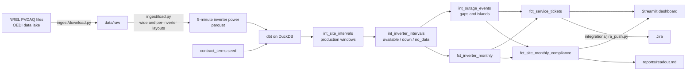

# Solar Fleet Contract Compliance

Tracks a fleet of real US commercial solar inverters against O&M contract guarantees, turns telemetry into service tickets, and shows the results on a compliance dashboard.

It mirrors three jobs of a commercial energy service operations team:

1. **Track contractual obligations:** monthly time availability, energy availability, data availability, and outage restore times, per site, against contract terms.
2. **Automate the compliance analysis:** a dbt project on DuckDB with tested models, refreshed weekly by GitHub Actions.
3. **Keep the code base reliable:** 43 dbt data tests, plus end-to-end pytest checks on fixtures with known injected faults, run on every push.

> **Data:** NREL PVDAQ 2023 Solar Data Prize datasets (public, US). **Contract terms are illustrative** and live in [`dbt/seeds/contract_terms.csv`](dbt/seeds/contract_terms.csv).

## Results

The pipeline workflow writes these on every run:

- [`reports/readout.md`](reports/readout.md): one-page readout with the headline numbers, four tested hypotheses, and what the data does and does not show
- [`reports/marts/`](reports/marts): scorecard, inverter-month, ticket and asset tables as CSV
- [`reports/schema_profile.md`](reports/schema_profile.md): what the loader found in each raw file

## How it works



### Metric definitions

| Metric | Definition |
|---|---|
| Production window | A 5-minute interval where the median normalized output of the site's reporting inverters is at least 10%, or where every inverter is near zero at a time the site normally produces (site-wide outage) |
| Inverter status | **available** if producing; **down** if under 2% of capacity during a production window; **no_data** if no reading arrived (a monitoring gap, not downtime) |
| Time availability | available / (available + down) intervals |
| Energy availability | actual energy / (actual energy + estimated lost energy) |
| Lost energy | For each down interval, what peers (or the site's typical profile, for site-wide outages) imply the inverter should have produced |
| Data availability | Intervals with a reading / production-window intervals |
| Outage event | Consecutive down intervals per inverter. Nights are not production windows, so an inverter still down the next morning stays in one event. Events of 30 minutes or more become tickets |
| Performance index | Energy produced while available / energy implied by peers. Under 0.90 for a month opens an underperformance ticket |

Capacity is a proxy: the 99.5th percentile of each inverter's observed AC power.

### Tests

- **dbt:** 43 tests covering keys, accepted statuses, ratio ranges, referential integrity, non-overlapping events, energy reconciliation between site and inverter tables, and every ticket tracing back to an event.
- **pytest:** [`tests/make_fixtures.py`](tests/make_fixtures.py) writes small files in the exact raw schemas with injected faults: an overnight outage, a 100-hour outage that breaches the SLA, a 15-minute dip that should not open a ticket, a communications gap that should not count as downtime, an inverter running at 80% of its peers, and a site-wide trip. [`tests/test_pipeline.py`](tests/test_pipeline.py) checks that the pipeline finds each one and nothing else.

## Run it

```bash
python -m venv .venv && source .venv/bin/activate
make setup
make test        # fixtures, loader, dbt build, assertions (no download)
make all         # download about 800 MB from NREL, load, dbt build, export, readout
make app         # dashboard at http://localhost:8501
make docs        # dbt docs and lineage graph
make jira        # dry run of the Jira push; see integrations/jira_push.py
```

The dashboard reads only `reports/marts/*.csv`, so it also runs straight from a fresh clone.

## Limits

- Contract terms, exclusions and liquidated-damages rates are illustrative, not from a real contract.
- Expected energy comes from peer inverters, not an irradiance model, so a site-wide outage cannot be told apart from heavy snow cover.
- Capacity is inferred from observed output, not nameplate data.
- Tickets are generated from telemetry. Real dispatch, repair and fault-code data would be needed to measure response times.

## Repository layout

```
config/          fleet definition (sites, files, column patterns)
ingest/          download and reshape raw files
dbt/             models, seed, tests, macros
analysis/        mart export and readout
app/             Streamlit dashboard
integrations/    Jira push
tests/           fixtures with injected faults and end-to-end tests
reports/         generated outputs (committed by the pipeline workflow)
```
